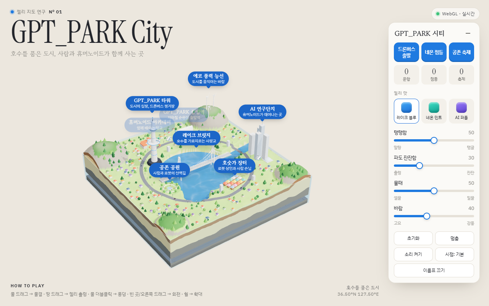
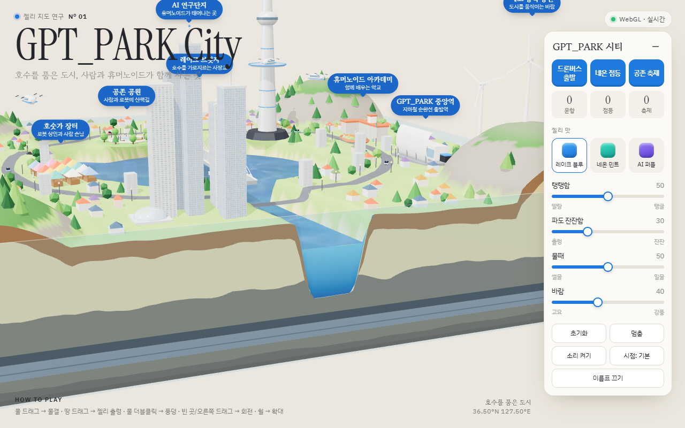

# GPT_PARK City · 우리 동네 젤리 지도 Nº 01

> 호수를 품은 도시, 사람과 휴머노이드가 함께 사는 곳

**▶ 라이브: https://gpt-park-city.vercel.app**

동네의 지형과 명소를 **투명한 젤리 블록 안 미니어처 디오라마**로 담은 Three.js 인터랙티브 3D 지도입니다.
물 위를 드래그하면 물결이 퍼지고, 땅을 드래그하면 젤리 블록 전체가 출렁입니다. 드론버스·지하철·자율주행차가 쉬지 않고 도시를 오갑니다.



| 단면: 호수 수로의 물벽 + 지층 + 지하철 터널 |
|---|
|  |

## 실행

```bash
npm install
npm run dev        # http://localhost:5173
npm run build      # dist/ 정적 파일
npm run preview    # 빌드 결과 미리보기 (http://localhost:4173)
```

## 조작

| 동작 | 결과 |
|---|---|
| 물 위 드래그 | 지나간 자리에 동심원 물결이 퍼지고 호숫가에서 반사 |
| 땅 · 건물 · 단면 드래그 | 젤리 블록 전체가 출렁 (탱탱함 슬라이더로 지속 시간 조절) |
| 물 위 더블클릭 / 더블탭 | 젤리 방울이 떨어지며 물보라 |
| 빈 곳 드래그 · 오른쪽 드래그 | 시점 회전 |
| 휠 · 두 손가락 핀치 | 확대 · 축소 |
| 제목 글자에 마우스 | 글자가 젤리처럼 튐 |

패널: 액션 3개(드론버스 출발 · 네온 점등 · 공존 축제) + 카운터, 젤리 맛 3가지, 슬라이더 4개(탱탱함 · 파도 잔잔함 · 물때 · 바람), 하단 버튼 5개(초기화 · 멈춤 · 소리 켜기 · 시점 · 이름표).

- `?record=1` — 1/60초 고정 간격 재생 + 패널 숨김 (영상 녹화용)
- 프레임이 2초 평균 40 FPS 미만이면 품질이 자동으로 한 단계 낮아집니다 (높음 → 중간 → 낮음).
- 운영체제의 "동작 줄이기" 설정을 켜면 자동 물결과 제목 흔들림이 꺼집니다.
- 소리는 기본 꺼짐. 모든 효과음은 Web Audio 로 합성합니다 (오디오 파일 0개).

## 다른 동네 버전 만들기 (config 만 바꾸기)

1. 이 저장소를 복제하고 `public/town.config.json` 을 엽니다.
2. `meta` (이름 · 영문 제목 · 좌표 · 소개 · 시리즈 번호)와 `terrain.type` 을 바꾸고, `terrain.shapes` 의 원 · 캡슐 · 상자로 땅 모양을 그립니다 (비워 두면 type 별 기본 지형). 좌표는 블록 중심 (0,0), x 동쪽, z 남쪽, 범위 −10 ~ +10.
3. `landmarks` 에 명소 5~8개를 넣습니다. `kind` 는 14종 키트(tower, bridge-cable, bridge-arch, hanok, lighthouse, windmill, mountain-rock, highrise, market, station, stadium, park, crane, school) 중에서 고릅니다.
4. `movers` 경로(`[[x,z], ...]`), `actions` 3개(효과: launch · horn · feed · drop · fireworks · rain · lights), `flavors` 3가지 색을 정합니다.
5. `npm run dev` 로 확인하고(틀린 항목은 오른쪽 아래 토스트로 알려 줍니다) `npm run build` 결과 `dist/` 를 배포합니다.

## 배포

- **Cloudflare Pages**: Build command `npm run build`, Output directory `dist`.
- **Vercel**: Framework preset `Vite` (자동 인식), Output `dist`.

모든 경로가 상대 경로(`base: './'`)라 하위 폴더에 올려도 동작합니다. three 는 npm 번들에 포함되어 CDN 이 막힌 환경에서도 열립니다 (웹폰트만 Google Fonts 사용, 실패하면 시스템 글꼴로 대체).

## 테스트

```bash
npm test           # Vitest 단위 테스트 (config · terrain · water · jelly)
npm run test:e2e   # 빌드 후 Playwright 스모크 (데스크톱 1280×800 + 모바일 390×844)
npm run size       # dist JS gzip 크기 (한도 350KB)
```

## 구조

```
src/
  main.ts          장면 조립, 렌더 루프, 리사이즈, 카메라 맞춤
  config.ts        town.config.json 로드 · 검증 · 타입
  terrain.ts       높이 함수(도형 합집합 + fBm), 지형 메시, 단면 지층, 지하철 터널
  water.ts         128격자 파동 방정식 높이장, 젤리 수면(transmission + caustics), 단면 물벽, 물보라 풀
  jelly.ts         감쇠 스프링 2종(전단 · 눌림) + 모든 재질에 주입하는 젤리 정점 변형
  landmarks/       키트 14종 (kind 1개 = 파일 1개) + 배치 · 겹침 처리
  fillers.ts       집 · 나무 · 가로등 · 사람과 휴머노이드 (InstancedMesh)
  movers.ts        드론버스 · 지하철 · 자율주행차 · 물고기 등 경로 이동, launch
  actions.ts       액션 효과 7종
  input.ts         포인터 · 더블클릭 · 휠 · 터치 (물 / 땅 / 빈 곳 구분)
  ui.ts            패널, 카운터, 슬라이더, 토스트, 젤리 제목, 이름표
  audio.ts         합성 효과음
  quality.ts       FPS 측정 · 자동 품질 단계
public/town.config.json
```

## 가정 목록

- A1. CDN 대신 npm 번들 · A2. 프레임워크 없는 순수 DOM · A3. CPU 128격자 물 시뮬 · A4. 도형 조합 지형 · A5. 소리 기본 꺼짐 · A6. 동네 1개 = 배포 1개 · A7. 레퍼런스 코드 · 문구 재사용 없음
- A8. 가상 도시라 좌표 `36.50°N 127.50°E` 는 임의값입니다.
- A9. 드론버스 = `bird` + `variant: dronebus`, 지하철 = `train` + `variant: subway`(블록 둘레 지하 터널, 옆면 유리 띠로 보임), 자율주행차 = `car` + `variant: autonomous`(센서 돔).
- A10. 드론 포트 키트가 없어 GPT_PARK 타워 중턱 원반을 드론버스 정거장으로 썼습니다 (`launch` 하면 이 원반에서 이륙해 한 바퀴 돌고 돌아옵니다).
- A11. 수용 기준 6번(바람 ↔ 풍차)을 위해 동북쪽 산 위에 풍력 발전기 능선(`windmill`)을 넣었습니다.
- A12. 스키마 확장(선택 항목): `landmarks[].zone`, `movers[].variant · altitude · depth`, `actions[].target`, `fillers.people · humanoids`.
- A13. `defaults.flavor` 는 0부터 셉니다.
- A14. 호수 단면이 옆면에 보이도록 호수에서 동쪽 가장자리까지 수로를 하나 냈습니다.
- A15. 터치 기기에서는 땅을 한 손가락으로 끌면 시점 회전(수용 기준 9), 땅을 짧게 탭하면 젤리가 출렁입니다.
